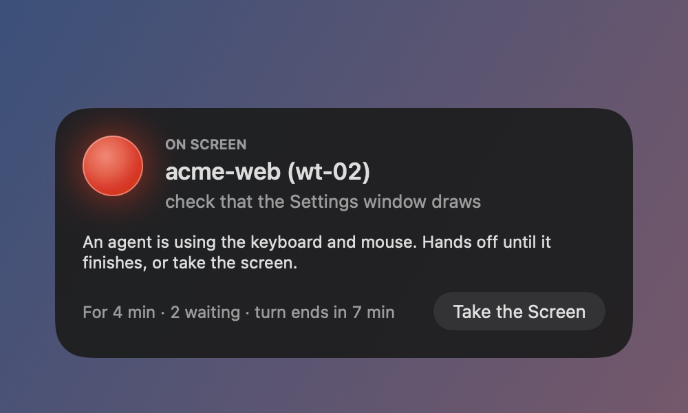

# mac-tally-lamp


A tally lamp for a Mac that agents share. Agents and the person at the Mac take turns with the screen, keyboard, and mouse, so they stop pulling focus from each other. The name comes from a broadcast tally light, which tells a studio which camera is live.

- An agent asks for the screen through MCP before it clicks, types, or brings an app forward, and gives it back when it is done. When someone else has it, the agent waits in line.
- While an agent has the screen, a lamp in the bottom-right corner says which agent has it and what it is doing.
- You can claim the screen from the menu bar, or take it from the lamp, at any time. Agents wait until you let it go.

It is cooperative. It tells agents whose turn it is, and nothing stops an agent that does not ask.



## Connecting an agent

The app carries an MCP server, `mac-tally-lamp-mcp`, in its bundle. Each agent session starts its own copy, which talks to the running app. Add it once per agent. For Claude Code, at user scope so every project gets it:

```sh
claude mcp add --scope user tally-lamp -- ~/Applications/mac-tally-lamp.app/Contents/MacOS/mac-tally-lamp-mcp
```

Settings, Agents shows this command with the app's real path, and the entry for other agents' `mcpServers` settings.

| Tool | What it does |
|---|---|
| `request_screen` | Gets the screen, or waits in line for it, up to `wait_seconds` (300 unless the agent says). Calling it again while holding renews the hold. |
| `release_screen` | Gives the screen back, or leaves the line. |
| `screen_status` | Says who has the screen and who is waiting. Changes nothing. |

The server also gives agents the rules when they connect: ask before taking focus, give the screen back right away, and never use it while someone else has it.

## Running it

- `scripts/bundle.sh --install` builds the app, moves it to `~/Applications`, and launches it. An agent's MCP server also starts the app in the background if it is not running.
- The menu bar icon is a bulb while the screen is free, a lit bulb while an agent has it, and a person while you have it, with the number waiting beside it. Its menu shows who has the screen and who waits, and has Claim the Screen, Release the Screen, Take the Screen, and End an agent's turn.
- While others wait, an agent keeps the screen for 10 minutes after it last asked, then the next in line gets it. Settings, Agents changes the limit. With nobody waiting, an agent keeps it until it lets go.
- The app keeps its socket, which the MCP servers connect to, in `~/Library/Application Support/mac-tally-lamp/`. Who has the screen lives in memory, so quitting the app clears it.

## Working on it

- `swift build` and `swift test` build the code and run the tests.
- Run only the bundle, not `swift run`. The bundle has the `Info.plist` that keeps the app out of the Dock, and the MCP server next to the app.
- `scripts/render-previews.sh` draws the lamp and every Settings section to `build/previews` without opening a window.
- `scripts/render-icon.sh` redraws the icon from `AppIconDrawing.swift`. `scripts/render-icon.sh 2` draws the other design.
- [AGENTS.md](AGENTS.md) has the rules for changing this repo, and [planning/](planning/decided.md) records what is decided and what is open.

## Releases and updates

A release build updates itself with [Sparkle](https://sparkle-project.org). It installs an update when nobody has the screen or waits for it, since a relaunch clears the line.

```sh
scripts/release.sh --check          # say whether this Mac can release now, and change nothing
scripts/release.sh 0.1.0 --dry-run  # build the files into build/release and publish nothing
scripts/release.sh 0.1.0            # build, sign, notarize, and publish v0.1.0 from main
```

A release is a GitHub Release with the zipped app and `appcast.xml`. The notarization login and the Sparkle signing key are shared with the other Mac apps. The public key is in `scripts/sparkle-public-key.txt`.

## License

MIT. See [LICENSE](LICENSE).
